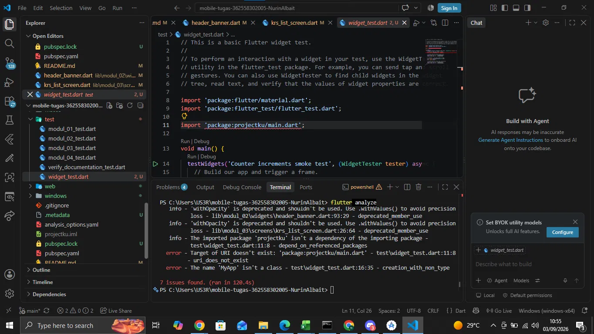

# Laporan Praktikum Modul 01: Mobile Ecosystem, Flutter Setup & Profile App

- **Nama**: [Nurin Albait]
- **NIM**: [362558303005]
- **Kelas / Prodi**: 2E / Sarjana Terapan TRPL
- **Mata Kuliah**: Pemrograman Perangkat Bergerak (Semester 3)

---

## 1. Ringkasan Aktivitas
[Minggu ini saya belajar dasar-dasar Flutter, mulai dari setup project, penggunaan widget untuk membangun UI, hingga membuat layout yang responsif (menyesuaikan tampilan mobile dan tablet). Saya juga mengerjakan Modul 1, serta belajar menjalankan dan memperbaiki widget test menggunakan flutter_test untuk memastikan aplikasi berjalan sesuai yang diharapkan.]

## 2. Bukti Tangkapan Layar (Running App)
[Sertakan minimal 2 screenshot bukti aplikasi profil berjalan di emulator atau HP fisik Anda]

## 3. Kendala yang Dihadapi & Solusinya
- **Kendala**: [flutter analyze: muncul error `Target of URI doesn't exist: 'package:projectku/main.dart'` dan `The name 'MyApp' isn't a class` pada file `widget_test.dart`]
- **Solusi**: [Memeriksa `pubspec.yaml` untuk mengetahui nama project yang sebenarnya (`poliwangi_mobile_starter`), lalu memperbaiki baris import di `widget_test.dart` agar sesuai. Selain itu, nama class yang dipanggil disesuaikan dari `MyApp` menjadi `PoliwangiStarterApp` sesuai dengan class utama yang ada di `main.dart`]

## 4. Jawaban Pertanyaan Refleksi
1. **Pilihan Native vs Flutter**: [ Flutter dipilih karena memungkinkan pengembangan aplikasi untuk Android dan iOS hanya dengan satu basis kode (cross-platform), sehingga lebih efisien dari segi waktu dan tenaga dibandingkan pengembangan native yang harus menulis kode terpisah untuk masing-masing platform (Kotlin/Java untuk Android, Swift untuk iOS). Selain itu, fitur Hot Reload pada Flutter mempercepat proses development karena perubahan kode bisa langsung terlihat hasilnya tanpa perlu rebuild aplikasi dari awal.]
2. **Prinsip UI = f(state)**: [Prinsip ini berarti tampilan (UI) aplikasi merupakan hasil murni dari data/state yang sedang berlaku pada suatu waktu. Ketika state berubah, Flutter akan otomatis membangun ulang (rebuild) widget yang bergantung pada state tersebut untuk mencerminkan kondisi terbaru, tanpa perlu memanipulasi tampilan secara manual seperti pada pendekatan imperatif. Contohnya bisa dilihat pada `AcademicDashboardScreen`, di mana perubahan `_isDarkMode` melalui `setState()` langsung mengubah tampilan tema aplikasi secara otomatis.]
3. **Pentingnya Conventional Commits**: [Conventional Commits penting agar riwayat perubahan kode (commit history) menjadi lebih terstruktur, mudah dibaca, dan konsisten antar anggota tim. Dengan format seperti `feat:`, `fix:`, atau `docs:`, setiap orang bisa dengan cepat memahami jenis perubahan apa yang dilakukan tanpa harus membaca detail kode. Hal ini juga memudahkan proses tracking bug, pembuatan changelog otomatis, dan kolaborasi dalam tim pengembangan software.]