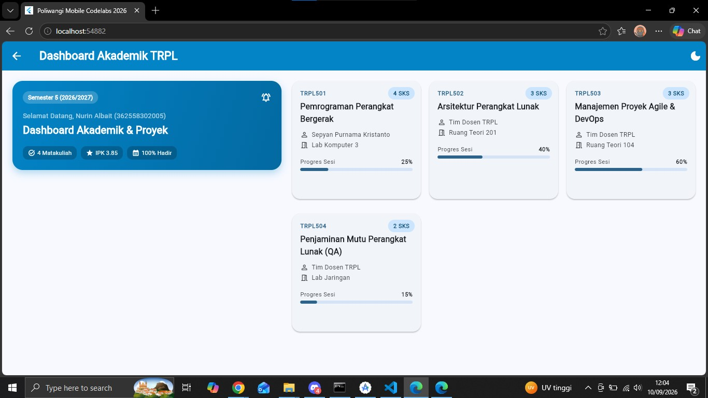
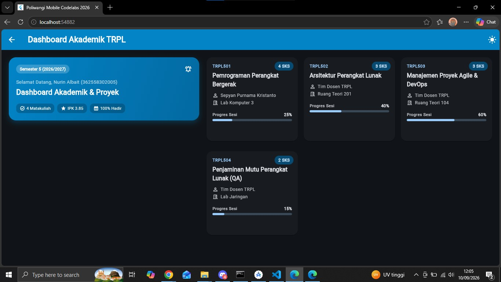
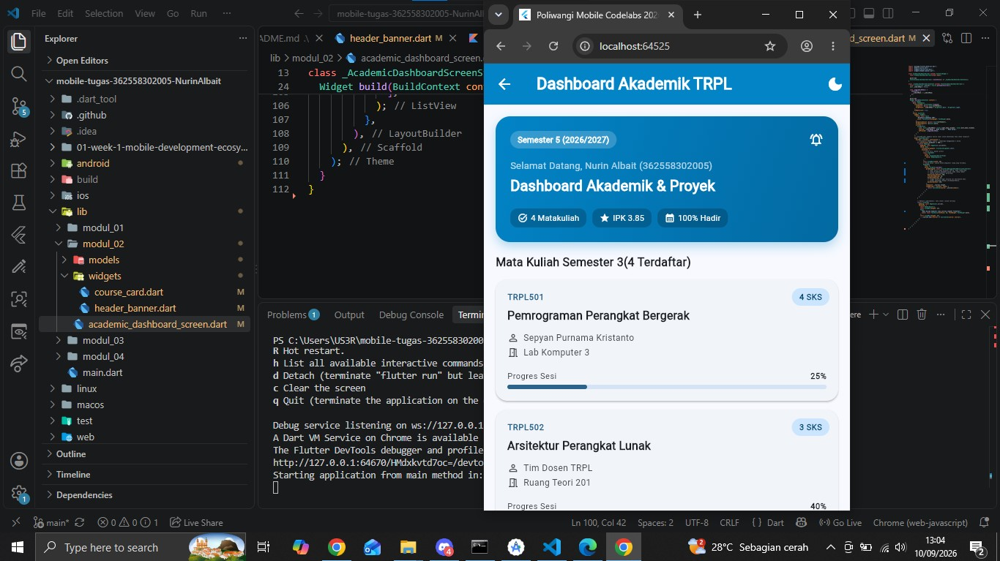

# Laporan Praktikum Modul 02: Declarative UI & Responsive Layout

- **Nama**: Nurin Albait
- **NIM**: 362558302005
- **Kelas / Prodi**: 2E / Sarjana Terapan TRPL
- **Mata Kuliah**: Pemrograman Perangkat Bergerak (Semester 3)

---

## 1. Ringkasan Implementasi
Pada praktikum Modul 02 ini, antarmuka Dashboard Akademik dibangun menggunakan paradigma deklaratif Flutter dan sistem desain Material 3:
- **Responsivitas dengan LayoutBuilder**: Mengatur batas adaptasi (*breakpoint*) pada lebar 600dp. Ketika lebar layar < 600dp (ponsel potret), daftar mata kuliah disusun dalam 1 kolom vertikal (`ListView`). Ketika lebar layar >= 600dp (tablet/desktop/lanskap), antarmuka secara otomatis bertransformasi menjadi 2 kolom grid (`GridView`).
- **Penerapan M3 Theme**: Menggunakan tema Material 3 terpusat yang mendukung peralihan dinamis antara *Light Mode* dan *Dark Mode* tanpa merusak keterbacaan teks dan kontras komponen kartu.
- **Komponen Interaktif**: 
  - Filter kategori mata kuliah menggunakan `Wrap` dan `ChoiceChip` dengan penanganan state `setState()`.
  - Detail silabus interaktif pada setiap `CourseCard` yang dibungkus `InkWell` dan memicu `showModalBottomSheet`.
  - Akumulasi total SKS secara dinamis menggunakan operasi fungsional `fold()`.

## 2. Bukti Tangkapan Layar (Running App)
| Mode Portrait (Light) | Mode Dark Theme | Mode Landscape / Tablet (2 Kolom) |
|---|---|---|
|  |  |  |

## 3. Kendala Layout yang Dihadapi & Solusinya
- **Kendala 1**: Terjadi `RenderFlex overflowed by 32 pixels on the right` pada widget `Row` di `header_banner.dart` saat diuji pada layar tablet.
- **Solusi**: Membungkus widget `Container` teks semester di dalam `Row` menggunakan widget `Flexible` agar ukuran lebarnya dapat menyusut secara fleksibel mengikuti sisa ruang parent.
- **Kendala 2**: Terjadi `RenderFlex overflowed on the right` pada teks nama dosen dan ruang kelas di dalam `CourseCard` saat kartu masuk ke mode 2 kolom grid.
- **Solusi** :Membungkus widget `Text` dosen dan ruangan di dalam `Row` menggunakan widget `Expanded`, serta menambahkan properti `maxLines: 1` dan `overflow: TextOverflow.ellipsis` agar teks panjang tidak menembus batas kartu.
- **Kendala 3**:Peringatan linter *deprecated member* `.withOpacity()` pada konfigurasi warna.
- **Solusi** :Mengganti pemanggilan fungsi lama tersebut dengan format terbaru Flutter yaitu `.withValues(alpha: ...)`.

## 4. Jawaban Pertanyaan Refleksi
1. **Efisiensi Single-pass BoxConstraints**: Prinsip *“Constraints go down, Sizes go up, Parent sets position”* memungkinkan proses penghitungan layout berjalan dalam satu kali penelusuran pohon (*single-pass tree walk*, kompleksitas $O(N)$). Parent memberikan batasan ukuran min/max ke bawah (anak), anak menentukan ukuran pastinya sendiri di dalam batasan tersebut dan mengembalikannya ke atas (parent), lalu parent menentukan posisi koordinat $(x,y)$ untuk anak tersebut. Karena tidak ada proses coba-coba berulang (*backtracking* atau *multi-pass measurement*) antar-komponen, Flutter dapat merender tata letak kompleks dengan sangat cepat dan stabil pada 60/120 FPS.
2. **Kriteria Modularisasi Widget**: Sebuah widget sebaiknya dipecah menjadi file terpisah (seperti `CourseCard`) jika widget tersebut bersifat dapat digunakan kembali (*reusable*) di tempat lain, memiliki struktur kode yang panjang/kompleks, atau mengelola interaksi sendiri (seperti memicu bottom sheet) demi menjaga prinsip keterpisahan tanggung jawab (*Separation of Concerns*). Sebaliknya, komponen cukup diletakkan sebagai *private widget* di file yang sama jika sifatnya sangat spesifik hanya untuk satu layar (*one-off layout piece*), berukuran ringkas, dan membutuhkan akses langsung ke state lokal milik widget induk tanpa harus memindahkan banyak parameter callback.
3. **Manfaat M3 ThemeData Terpusat**: Penggunaan `ThemeData` terpusat bertindak sebagai *Single Source of Truth* untuk seluruh gaya visual aplikasi. Jika terjadi perubahan identitas warna, ketebalan tipografi, atau radius sudut, pengembang hanya perlu mengubah nilainya di satu tempat (`main.dart`), dan perubahan akan langsung terdistribusi ke seluruh widget melalui `Theme.of(context)`. Pola ini mencegah terjadinya warna *hardcoded* yang rawan salah, memudahkan pemeliharaan kode jangka panjang, serta membuat fitur peralihan *Dark Mode* / *Light Mode* bekerja secara mulus dan konsisten di setiap layar.