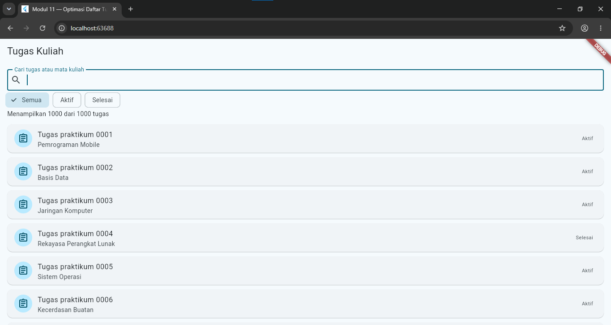
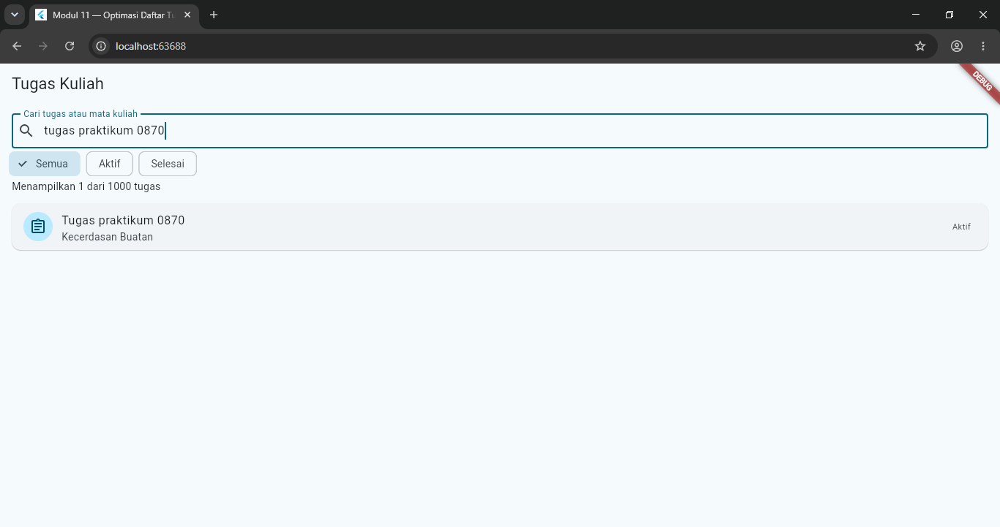
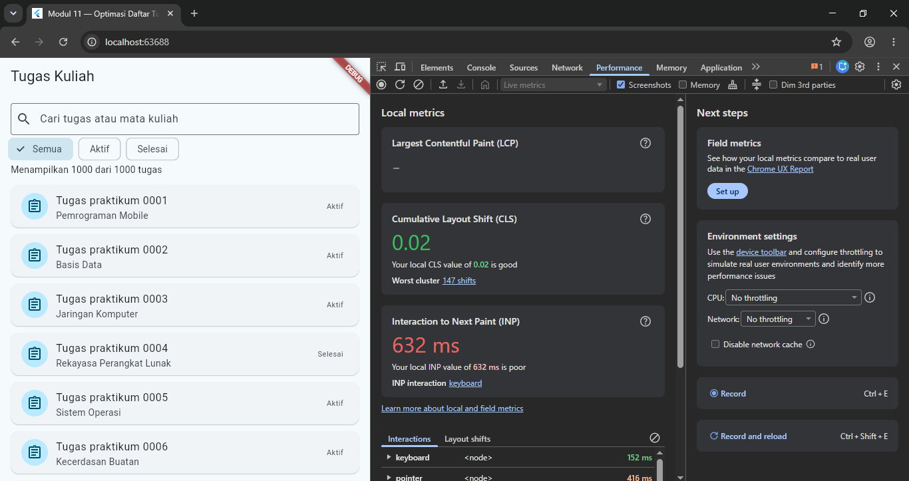
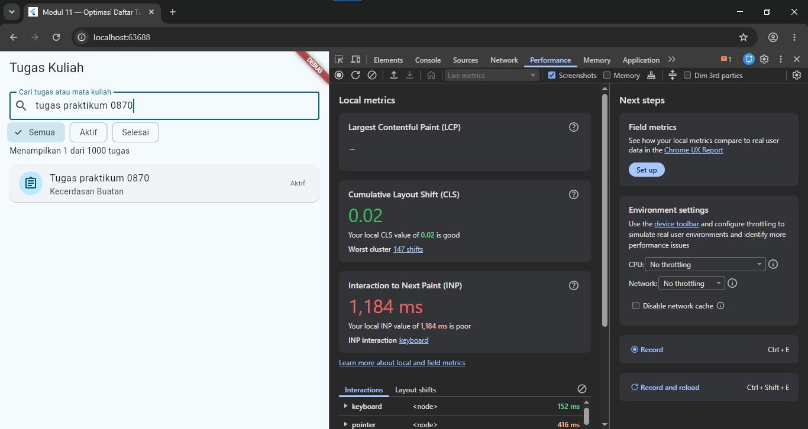

# Laporan Praktikum Modul 11: Optimasi Performa

**Nama**: Nurin Albait
**NIM**: 362558302005
**Kelas / Prodi**: 2E / Sarjana Terapan TRPL
**Mata Kuliah**: Pemrograman Perangkat Bergerak (Semester 3)

## 1. Ringkasan Implementasi

Praktikum ini mengamati performa daftar 1.000 tugas kuliah di Flutter. Fitur yang dipelajari:
Data sumber (_semuaTugas) dipisahkan dari hasil penyaringan (_hasil).
Pencarian teks dan filter status (Semua, Aktif, Selesai) bekerja bersamaan.
ListView.builder hanya membangun kartu yang terlihat, bukan 1.000 sekaligus.

## 2. Bukti 
A. Tampilan Awal
Menampilkan "Menampilkan 1000 dari 1000 tugas" dengan daftar kartu tugas. Tampilan Awal

B. Pencarian
Mengetik tugas praktikum 0870 menampilkan 1 dari 1000 tugas. Pencarian

C. Pengukuran Performa
Diukur dengan panel Performance Chrome DevTools pada mode debug di browser.

Sebelum pencarian: INP 632 ms, CLS 0,02. DevTools Sebelum Pencarian
Setelah mengetik pencarian: INP naik menjadi 1.184 ms (interaksi terburuk: keyboard), CLS tetap 0,02. DevTools Setelah Pencarian
Catatan: angka ini diambil di mode debug pada browser, sehingga tidak mewakili performa di perangkat mobile dan tidak dibandingkan dengan profile mode.

## 3. Refleksi
Data sumber vs hasil penyaringan: _semuaTugas selalu berisi 1.000 tugas dan tidak diubah. _hasil adalah daftar baru hasil penyaringan berdasarkan status dan teks pencarian.
Mengapa ListView.builder: item dibuat hanya saat dibutuhkan, sehingga hemat memori dan waktu build dibanding membangun semua kartu sekaligus.
Pengukuran performa: INP yang tinggi saat mengetik menunjukkan input keyboard menjadi interaksi paling lambat, karena setiap ketikan menjalankan setState dan penyaringan ulang 1.000 data. Namun karena diukur di mode debug, angka ini hanya sebagai pengamatan awal, dan pengukuran yang valid dilakukan di profile mode.

A: 
B: 
C: 
D: 